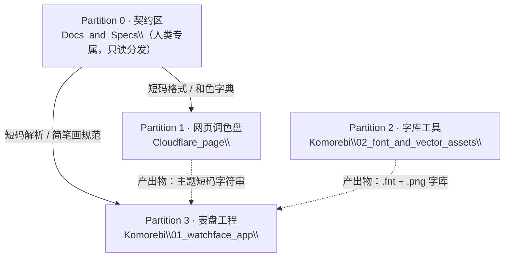

# Garmin Connect IQ — 多智能体分区指令 (AI_TASKS.md)

> 用法：把某个 Partition 的代码块**整段复制**给一个 AI 会话（VS Code / Cursor / Claude / ChatGPT 等），一个会话只投喂一个分区。
> 依据：[`WORKFLOW.md`](WORKFLOW.md)（目录锁与 SOP）、[`DECISIONS.md`](DECISIONS.md)（架构决策）、[`Docs_and_Specs/`](Docs_and_Specs)（契约）。
> 收尾：完成后删除自建 `TODO_PARTITION_{N}.md`，成果追加到 [`result.md`](result.md)。

---

## 0. 四条基础军规（每个会话开场必贴）

1. **严格目录锁**：只能在指派目录内创建/修改/删除文件，绝不越界改其他分区源码。
2. **契约先行**：`Docs_and_Specs\THEME_PROTOCOL.md` 与 `JAPANESE_PALETTE_SPEC.md` 是唯一接口来源。**发现契约不够用必须停下报告，禁止私改**。
3. **Mock-First**：依赖的分区没做好就**不要等**，用协议示例短码 / 系统字体 / 内存桩在自己目录内自测闭环。
4. **质量标准**：Monkey C 编译 0 错误 0 警告；网页 Chrome 与手机视口无 console 报错；Python 脚本幂等可重跑；禁止硬编码绝对路径与私钥。

---

## 1. 分区拓扑（无环依赖）



P1 与 P2 可完全并行；P3 只消费产出物，不读它们的源码实现。

---

## 2. 分区工单（Ready-to-Copy Prompts）

### Partition 1 · Cloudflare Pages 网页调色盘

```markdown
[AI Work Order - Partition 1: HTML5 和色调色盘]

1. 范围与目录锁：
   - 唯一可写目录：d:\Garmin\Cloudflare_page\
   - 只读参考：d:\Garmin\Docs_and_Specs\THEME_PROTOCOL.md、JAPANESE_PALETTE_SPEC.md、
     d:\Garmin\Komorebi\PROJECT_PLAN.md（第三/四/六/七节）
   - 禁止修改上述文件与任何其他目录。

2. 核心目标：
   - 纯静态零后端单页：index.html / style.css / app.js（不引入构建工具与后端）。
   - 实现 buildThemeCode() 与 parseThemeCode()，字段顺序严格为
     F{1-5}-B{0-6}-A{0-2}-{7×HEX}；用协议中 4 套默认主题串做断言自测。
   - 内置 48 种日本传统和色色卡，按 6 大色系分类（日文/罗马音/HEX）。
   - Canvas 1:1 圆形表盘仿真：错落大时间（大小时居左偏中 / 分钟贴右弧 / 秒钟补齐落差）、
     6 套简笔背景（B1 远山日轮 / B2 浮世流云 / B3 水墨层峦 / B4 细雨涟漪 / B5 雪峰寒星 / B6 弦月眠猫）、
     弧线三档（A0 关 / A1 细弧 / A2 分段）。
   - 「MIP 64 色模式」开关：逐通道量化到 00/55/AA/FF，并排显示原始色与量化色。
   - 一键复制短码 + Garmin Connect 粘贴位置指引。

3. 验收标准：
   - 4 套默认主题短码解析/生成双向一致；非法输入被拒绝并提示。
   - 手机 375px 与桌面 1440px 视口布局正常，console 无报错。
   - 坐标比例以「占屏幕宽度百分比」表达，便于 1:1 翻译到 Monkey C。
```

### Partition 2 · 字库与矢量资源工具

```markdown
[AI Work Order - Partition 2: 数字字库自动构建工具]

1. 范围与目录锁：
   - 唯一可写目录：d:\Garmin\Komorebi\02_font_and_vector_assets\
   - 只读参考：d:\Garmin\Komorebi\PROJECT_PLAN.md 第三节（5 套字体方案）
   - 禁止修改 01_watchface_app\ 与仓库其他目录（产物由人工拷贝，不由脚本直接写入）。

2. 核心目标：
   - build_fonts.py（Pillow）：输入 .ttf/.otf + 像素高度，输出 Garmin BMFont 的 .fnt + .png。
   - 字符集硬限制为 "0123456789:" 共 11 字符；单套产物 > 8KB 直接报错退出。
   - 目录约定：ttf_sources\（原始字体）、bmfont_configs\（导出配置）、out\<FontId>\（产物）。
   - 支持一次批量输出 F1~F5 五套（裂开数字 / 宋体衬线 / 硬派黑体 / 八段数码管 / 辉光管）。
   - 可选特效：字形中部斜裂隙、数码管网格镂空（P3 阶段实现，先留接口）。

3. 验收标准：
   - python build_fonts.py 可重复执行且幂等，产物字符集与页宽/行高字段自洽。
   - 打印每套字库体积与字符数校验表；越界即非零退出码。
```

### Partition 3 · Garmin Monkey C 表盘工程

```markdown
[AI Work Order - Partition 3: Komorebi 表盘 Monkey C 实现]

1. 范围与目录锁：
   - 唯一可写目录：d:\Garmin\Komorebi\01_watchface_app\
   - 只读参考：d:\Garmin\Docs_and_Specs\THEME_PROTOCOL.md、JAPANESE_PALETTE_SPEC.md、
     d:\Garmin\Komorebi\PROJECT_PLAN.md、d:\Garmin\DECISIONS.md
   - 禁止修改 Cloudflare_page\ 与 02_font_and_vector_assets\。

2. 契约与依赖（Mock-First）：
   - 字库尚未产出期间：使用系统字体 + 协议 4 套示例短码作为默认值驱动开发与自测，
     不得跨目录去写字库脚本。
   - 短码解析必须容错：字段缺失/长度错误/非法 HEX 一律安全回落到默认主题，禁止抛异常。

3. 核心目标：
   - ThemeManager.mc：短码解析 + 4 套默认日夜主题 + MIP 64 色最近邻吸附（逐通道 00/55/AA/FF）。
   - TimeRenderer.mc：错落大时间排版，坐标全部 width * ratio，禁止绝对像素。
   - MinimalBgDrawer.mc：B0 自动跟随天气与日出日落，B1~B6 纯代码矢量，线宽 1~2px，禁止 PNG。
   - WatchFaceView.mc：AOD 息屏保护（休眠隐藏秒针与重度图层）；秒钟走 onPartialUpdate 局部裁剪。
   - DataFieldsDrawer.mc：顶部电池+天气；底部身体数据矩阵（HR/BB/压力/步数/卡路里/血氧/日期）。
   - DataProvider.mc：SensorHistory / Weather 数据聚合缓存，避免每帧重复取数。

4. 验收标准：
   - Monkey C 编译 0 错误 0 警告；模拟器 F5 选 fenix7（MIP）与 fr965（AMOLED）均正常渲染。
   - 输入协议 4 套示例短码（AMOLED 与 MIP 两版）显示结果与 Docs 描述一致。
   - resources\ 下无背景类 PNG；source\*.mc 无分辨率硬编码像素常量。
```

---

## 3. 集成期人工动作（不分发给 Agent）

1. P2 产物 `out\<FontId>\*.fnt|*.png` 拷入 `01_watchface_app\resources\fonts\` 并在 `resources.xml` 注册。
2. `Cloudflare_page\` 部署 Cloudflare Pages，手机浏览器实测生成短码。
3. 短码粘贴进 Garmin Connect 表盘设置 → 蓝牙同步 → 手表即时换肤验收。
4. `Monkey C: Build for Device` 导出 `.prg` → 拖入手表 `/GARMIN/APPS/` 真机验收。
