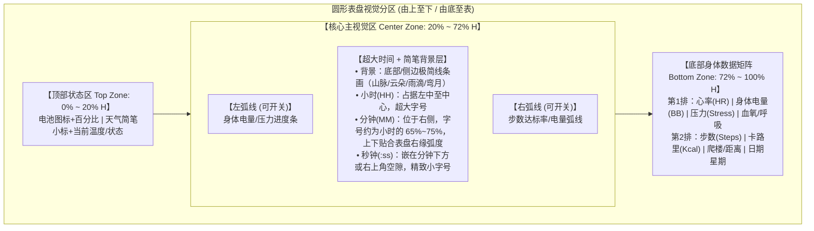
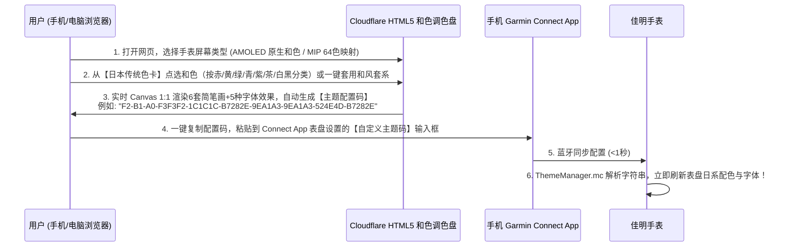

# 佳明 (Garmin Connect IQ) 定制表盘全栈规划书

> **项目定位**：高颜值、大字号核心时间、简笔矢量天气极简背景、多字体切换 + Cloudflare Pages 在线 HTML5 可视化调色盘配置器。
> **设计参考**：
> - **布局参考**：`Enduro2 MB` (`787d97ad-a7cb-41f6-93fd-1897aec95caa`) —— 高密度上下分区数据 + 中心视觉聚焦 + 左右弧形进度条。
> - **背景风格参考**：`Sakura Cat` 等 (`10aa616e-...` / `8ddbf5be-...`) —— 无需重度位图（避免内存溢出与耗电），采用**代码级几何线条 / 轻量级单色剪影字库图标**勾勒简笔极简风背景。

---

## 一、 开发环境与 IDE 准备（基于“微软大战代码” VS Code）

佳明官方早已全面转向 **VS Code**，你电脑上已有 VS Code，只需补充以下 3 个组件即可跑通编译、模拟器预览和真机侧载：

### 1. 必装组件清单
1. **Java 运行环境 (JDK)**：建议安装 **JDK 11 或 JDK 17**（Garmin SDK 编译底层依赖 Java）。
2. **Garmin Connect IQ SDK Manager**：
   - 下载地址：[Garmin Connect IQ SDK 官方下载页](https://developer.garmin.com/connect-iq/sdk/)
   - 安装后打开 `SDK Manager`：
     - 在 **SDK** 标签页下载最新稳定版 SDK（如 `7.x` 或 `8.x`），并点击 **Use as current SDK**。
     - 在 **Devices** 标签页勾选你的手表型号（如 `Fenix 7 / 7 Pro`, `Forerunner 255 / 265 / 955 / 965`, `Epix Gen 2` 等）下载模拟器固件。
3. **VS Code 官方插件**：
   - 打开 VS Code 扩展商店，搜索并安装：**`Monkey C`**（发布者：`Garmin`）。
   - 安装后按 `Ctrl + Shift + P`：
     - 输入 `Monkey C: Verify Installation` 检查 SDK 路径是否绑定。
     - 输入 `Monkey C: Generate a Developer Key` 生成开发者签名密钥（保存好生成的 `.der` 文件，编译必用）。

### 2. 本地模拟器运行与真机安装
- **模拟器运行**：在 VS Code 按 `F5`（选择目标手表型号），会自动拉起 Connect IQ Simulator 实时看效果。
- **打包上真机（免上架白嫖自用）**：
  - `Ctrl + Shift + P` -> `Monkey C: Build for Device` -> 选择你的手表型号 -> 输出 `.prg` 文件。
  - 手表用数据线连电脑，将 `.prg` 文件直接拖入电脑识别出的手表盘符 `/GARMIN/APPS/` 目录下，拔线即用！

---

## 二、 工作分区（Workspace 目录架构）

当前工作区 `d:\Garmin` 已按功能模块划分为 4 个独立工作分区，后续让普通模型（如 Flash / Sonnet / 低配模型）写代码时，只需让它一次专注一个目录即可，极大节省 Token：

```text
d:\Garmin\
├── PROJECT_PLAN.md                 # 【总纲】本规划文档
├── 01_watchface_app\               # 【核心分区1】Garmin Monkey C 表盘工程源码
│   ├── manifest.xml                # 设备兼容性、权限声明（天气、心率、身体电量等）
│   ├── monkey.jungle               # 多分辨率/屏幕材质（MIP 反射屏 vs AMOLED）构建配置
│   ├── resources\
│   │   ├── fonts\                  # 5套打包好的自定义点阵字库 (.fnt + .png)
│   │   ├── drawables\              # 简笔矢量/图标资源配置
│   │   └── settings\               # Garmin Connect App 手机端设置项 (properties.xml / settings.xml)
│   └── source\
│       ├── WatchFaceApp.mc         # 应用入口与配置监听
│       ├── WatchFaceView.mc        # 主渲染管线（生命周期、息屏 AOD 保护）
│       ├── ThemeManager.mc         # 4套默认日夜配色 + 16进制调色码解析器
│       ├── TimeRenderer.mc         # 核心大时间渲染（大小时、贴边缩进分钟、小秒钟、多字体切换）
│       ├── MinimalBgDrawer.mc      # 简笔几何背景绘制器（晴/云/雨/雪/夜月纯代码矢量绘制）
│       ├── DataFieldsDrawer.mc     # 顶部（电池/天气）+ 底部（身体数据矩阵）+ 左右可选弧形条
│       └── DataProvider.mc         # 系统传感器与 Weather API 数据聚合缓存
│
├── 02_font_and_vector_assets\      # 【资源分区2】字体制作与简笔图工具脚本
│   ├── ttf_sources\                # 存放 5 种风格的原始 .ttf/.otf 字体文件
│   ├── bmfont_configs\             # BMFont 导出配置（仅导出 0-9 和 : 节省 90% 内存）
│   └── build_fonts.py              # 自动将 TTF 转为 Garmin .fnt + .png 的 Python 辅助脚本
│
├── 03_cloudflare_palette_web\      # 【网页分区3】Cloudflare Pages 零后端 HTML5 调色盘
│   ├── index.html                  # 单页式表盘实时 Canvas/SVG 预览 + 调色器
│   ├── style.css                   # 响应式暗黑/明亮 UI
│   └── app.js                      # 实时仿真渲染 + 一键生成“6位主题短码”复制到 Garmin Connect
│
└── 04_docs_and_specs\              # 【文档分区4】数据字典、配色色值表与屏幕坐标规范
```

---

## 三、 表盘视觉与版面架构设计（UI/UX 拆解）

以圆形表盘（以 `260x260` MIP 屏与 `454x454` AMOLED 屏双基准，代码中全部采用 **百分比相对坐标 `width * ratio`**）为例，将表盘划分为 **5 大图层与区域**：



### 1. 核心时间区（“大小时 + 贴合曲线的稍小分钟 + 小秒钟”）
- **视觉重心**：时间区域占整个表盘面积的 **50% 以上**。
- **不对称错落排版（贴合圆形边缘曲线）**：
  - **小时 (`HH`)**：居左偏中（X 轴约 `15% ~ 58%`），垂直居中偏上，使用**超大号自定义字库**（高度约占屏幕直径的 `34% ~ 38%`）。
  - **分钟 (`MM`)**：紧挨小时右侧（X 轴约 `60% ~ 88%`），字号设定为小时的 **`65% ~ 70%`**。为了**贴合圆形表盘右侧弧线**，分钟整体略微向内或沿上弧线对齐，右上角留给曲线余量。
  - **秒钟 (`ss`)**：放置在分钟正下方（刚好补齐“大小时”与“小分钟”之间的高度落差！）这样 `小时高度 ≈ 分钟高度 + 秒钟高度`，形成一个极其稳固的黄金矩形，且右侧上下两端完美贴合圆形表盘的弧边！
  - **局部刷新优化 (`onPartialUpdate`)**：秒钟独立圈定 Clip 裁剪框，支持 MIP 屏每秒极低功耗刷新（不刷全屏，省电）。

### 2. 五大精选数字字体方案（极低内存实现）
Garmin 手表内存极为有限（老机型几十 KB，新机型几百 KB），但因为**主时间只需要 `0123456789:` 共 11 个字符**，一套自定义位图字体（`.fnt` + `.png`）只需占用 **3KB ~ 8KB**！我们可以轻松内置 5 套字体供随时切换：

| 编号 | 字体风格 | 视觉特征与推荐开源/系统字体源 | 适用场景 |
| :--- | :--- | :--- | :--- |
| **Font 1** | **iPhone 裂开数字风** (Stencil / Split) | 类似 iOS 16/17 锁屏中间带镂空裂纹的现代几何数字（可基于 *SF Pro Rounded Stencil* 或通过 Python 脚本自动在字形中部切出一道优雅的斜裂隙） | 现代时尚、运动潮酷 |
| **Font 2** | **经典衬线/宋体风** (Times / Serif) | 高对比度粗细线条、带锋利衬线脚（如 *Times New Roman Bold* / *Playfair Display*） | 商务正装、机械腕表感 |
| **Font 3** | **凌厉黑体/无衬线** (Sans-Serif Heavy) | 极窄高耸或厚重现代几何黑体（如 *Bebas Neue* / *Oswald* / *DIN Condensed*） | 户外硬派（Enduro 原生感） |
| **Font 4** | **复古电子表数码管** (7-Segment LCD) | 经典卡西欧方块八段数码管，可选绘制一层极淡的“88:88”未点亮底影（如 *DSEG7 Classic*） | 复古极客、高辨识度 |
| **Font 5** | **赛博辉光管** (Nixie Tube) | 模仿苏联 IN-14 辉光管内部金属丝层叠骨架，配合暖橙色配色绝佳（如 *Nixie One* 加粗修饰或定制辉光网格） | 夜间模式、蒸汽朋克风 |

> **工程技巧**：在 `02_font_and_vector_assets` 中写一个 Python (`Pillow`) 脚本，不仅能一键把任何 `.ttf` 切成 Garmin 用的 `.fnt`，还能**自动给任何字体加上“iPhone 中间裂开”的镂空特效**或**数码管网格镂空特效**！

---

## 四、 简笔风格背景设计（零图片、纯代码矢量绘制）

为了实现你提到的 `Sakura Cat` 等简笔画表盘的质感，同时**不引入沉重的 PNG 背景图**（彻底告别锯齿与内存不足），我们采用 **`Dc` 画布矢量几何 API (`drawArc`, `drawLine`, `fillPolygon`, `drawCircle`) + 轻量线条插画坐标集**，并把繁琐的天气简化为 **4+1 种极简意境模式**：

### 简化后的 6 态日系简笔意境（自动跟随天气与日出日落，也可手动锁定）
1. **晴朗 · 远山日轮 (Clear / Fuji Sun)**：
   - 简笔富士山/远山折线轮廓 + 一轮极简朱红/留白空心太阳 + 一两笔水平霞云线。
2. **多云 · 浮世流云 (Cloudy / Ukiyo Cloud)**：
   - 简笔远山 + 错落的 2~3 朵日式横卷流云线条（现代极简 Line-Art 的横向圆角平行线条，轻巧穿过数字底部）。
3. **阴天/薄雾 · 水墨层峦 (Overcast / Mist Peaks)**：
   - 双层交错的远近山峦剪影线 + 水平断续雾气横线，营造京都山间晨雾的留白感。
4. **雨天 · 细雨涟漪 (Rainy / Raindrop Ripple)**：
   - 简笔云弧 + 3~5 根 45° 倾斜的极简细雨丝 + 底部一圈同心椭圆水波涟漪。
5. **雪天 · 雪峰寒星 (Snowy / Snow Crest)**：
   - 简笔覆雪山尖（双层折线）+ 散落的极简六角几何雪花与十字星点。
6. **夜晚 · 弦月眠猫/露营 (Night / Crescent & Cat)**：
   - 自动根据日落时间切换：低矮山坡弧线 + 一弯极简新月 + 3 颗十字小星辰 + 一只趴在山坡看月亮的极简一笔画小猫剪影（致敬 `Sakura Cat` 风格）。

> **视觉融合度**：所有简笔背景线条默认使用日本传统色中的 **“鼠系/茶系过渡色 (Muted Wa-iro)”**，线宽控制在 `1px ~ 2px`，既具日系杂志/手账质感，又绝不抢占中心大时间的阅读对比度。

---

## 五、 顶部、底部身体数据与左右弧线设计

### 1. 顶部状态栏（Top Zone）
- **左半侧（电池）**：极简横置电池外框 + 内部电量填充块 + 精确百分比数字（如 `86%`，可选切换为预计续航天数 `14d`）。低电量（<20%）自动高亮告警色。
- **右半侧（天气）**：微型简笔天气图标 + 当前温度（`24°C`）+ 简短状态或降水概率（`晴 10%` 或高低温 `18°/26°`）。

### 2. 底部身体数据矩阵（Bottom Zone —— “一大堆身体数据”）
采用紧凑清晰的 **上4 + 下3（或上3 + 下2）蜂窝/网格阵列**，每个槽位均由 `微型矢量图标 + 数值` 组成，且可在设置中自定义槽位内容：
- **核心默认展示项**：
  1. **心率 (Heart Rate)**：实时心率数值 + 跳动小爱心
  2. **身体电量 (Body Battery)**：闪电图标 + `0~100` 数值（Toybox.SensorHistory）
  3. **压力分数 (Stress Score)**：压力计图标 + `0~100`
  4. **步数 (Steps)**：脚印图标 + 当日步数（过万自动显示 `12.4k` 防溢出）
  5. **活动卡路里 / 总卡路里 (Calories)**：火焰图标 + `kcal`
  6. **血氧 (SpO2) 或 呼吸频率 (Respiration)** 或 **爬楼层数 (Floors)**
  7. **底栏收尾（贴合底弧）**：`日期 + 星期`（如 `11-20 周五` / `FRI 20 NOV`）

### 3. 左右边缘弧形进度条（可一键彻底关闭）
- 因为你觉得进度条“意义不大”，我们在设置中将其设为 **默认关闭（或极细暗线模式）**。
- 提供 3 档开关：
  - `关闭 (Off)`：画面更干净，给中间大时间和简笔背景留出最大呼吸感。
  - `极简细弧 (Thin Arc)`：仅 `2px` 宽度的刻度弧线，左弧绑定**身体电量**，右弧绑定**每日步数目标百分比**。
  - `Enduro 刻度弧 (Segmented Bar)`：还原 Enduro 2 风格的胶囊分段进度条。

---

## 六、 4 套默认日系传统配色（日本の伝統色：昼 x2 + 夜 x2）

基于 [日本传统色系 (Japanese Traditional Colors)](https://www.color5.com/color-system/japanese-traditional-colors/)，摒弃高饱和刺眼的欧美运动荧光色，全面采用 **和风低饱和、干净克制、高辨识留白** 的日系设计美学。支持**跟随日出日落自动切换昼/夜和色**，同时在网页调色盘中内置完整的“日本传统色卡（和色字典）”：

| 模式类别 | 主题名称（和风意境） | 背景和色 (Bg) | 小时主色 (Hour) | 分钟/朱印点缀 (Min) | 简笔背景线条 (Line) | 身体数据与图标 (Data) | 日系传统色构成与风格描述 |
| :--- | :--- | :--- | :--- | :--- | :--- | :--- | :--- |
| **昼 · 壱** | **白练 · 茜素** (Shironeri & Akane) | `白練` `#F3F3F2`<br/>*(MIP:`#FFFFFF`)* | `墨色` `#1C1C1C`<br/>*(MIP:`#000000`)* | `茜色` `#B7282E`<br/>*(MIP:`#AA0000`)* | `素鼠` `#9EA1A3`<br/>*(MIP:`#AAAAAA`)* | `消炭色` `#524E4D` / `茜色` | **日式留白与朱印**：如和纸手账般干净，墨色大字配一抹传统茜红，简笔远山如淡墨勾勒 |
| **昼 · 弐** | **鸟之子 · 青磁** (Torinoko & Seiji) | `鳥の子色` `#EFEACC`<br/>*(MIP:`#FFFFAA`)* | `鉄御納戸` `#2B373B`<br/>*(MIP:`#000055`)* | `青磁色` `#69B0AC`<br/>*(MIP:`#00AAAA`)* | `白茶` `#BC9F77`<br/>*(MIP:`#AA5500`)* | `千歳茶` `#494A41` / `常磐緑` | **京都和纸与青瓷**：温润的淡卵壳和纸底色，搭配沉稳的铁御纳户深蓝与青磁绿，极简治愈 |
| **夜 · 壱** | **胜色 · 樱月** (Kachiiro & Sakura) | `黒橡` `#0B1013`<br/>*(MIP:`#000000`)* | `卯の花色` `#F7FCFE`<br/>*(MIP:`#FFFFFF`)* | `桜色` `#FEDFE1`<br/>*(MIP:`#FFAAAA`)* | `藍鼠` `#566C73`<br/>*(MIP:`#5555AA`)* | `薄鈍` `#ADADAD` / `退紅` | **京都夜樱与蓝染**：深邃的蓝黑底色，配清透的樱粉色分钟与蓝鼠色简笔夜月/小猫剪影 |
| **夜 · 弐** | **消炭 · 琥珀宵** (Keshizumi & Kohaku) | `呂色` `#0C0C0C`<br/>*(MIP:`#000000`)* | `砥粉色` `#F4DDA5`<br/>*(MIP:`#FFFFAA`)* | `琥珀色` `#CA7A2C`<br/>*(MIP:`#FF5500`)* | `藤煤竹` `#5A5359`<br/>*(MIP:`#555555`)* | `灰汁色` `#9E9478` / `山吹色` | **昭和暖灯与琥珀**：温润不刺眼的砥粉暖米色与琥珀金，搭配辉光管或宋体衬线极具日系复古感 |

> **双色域自适应**：表格上方为 **AMOLED 真彩屏 & 网页端精准日本传统色值**，括号内 `*(MIP: ...)*` 为自动映射到佳明反射屏 64 色硬件调色板的最接近和色值。

---

## 七、 Cloudflare Pages 在线 HTML5 「日本传统色」调色盘规划

为什么需要网页调色盘？因为 Garmin Connect 手机 App 自带的设置菜单非常死板（只能选下拉列表或手输数字，没有颜色预览）。
通过做一个托管在 **Cloudflare Pages** 上的纯前端 HTML5 调色盘，我们将 **[日本传统色系 (Japanese Traditional Colors)](https://www.color5.com/color-system/japanese-traditional-colors/)** 完整内嵌为可视化色卡，你可以**点击任意日本传统色名（如“浅葱”、“露草”、“山吹”、“抚子”、“留绀”）实时赋色给表盘各个部位 -> 一键生成短代码 -> 粘贴到手机 Garmin Connect -> 手表秒变日系定制配色！**

### 1. 核心交互流程与“短码协议”


### 2. HTML5 日系调色盘功能清单（纯静态单页，Cloudflare Pages 秒部署）
- **内置完整「日本の伝統色」交互色卡库**：
  - 按传统色系分类展示（带日本汉字色名、罗马音、HEX 色值及和纸质感色块）：
    1. **白・灰・黒系（和纸与水墨）**：`白練`、`胡粉`、`鳥の子色`、`卯の花色`、`素鼠`、`銀鼠`、`消炭色`、`墨色`、`呂色`
    2. **赤・桃・紅系（朱印与春樱）**：`桜色`、`退紅`、`一斥染`、`撫子`、`珊瑚色`、`朱色`、`茜色`、`弁柄色`、`蘇芳`
    3. **黄・橙・茶系（秋叶与琥珀）**：`砥粉色`、`山吹色`、`鬱金`、`琥珀色`、`狐色`、`白茶`、`朽葉色`、`千歳茶`
    4. **緑・青緑系（竹林与青磁）**：`白緑`、`若竹色`、`青磁色`、`千歳緑`、`常磐色`、`青竹色`、`錆青磁`
    5. **青・藍系（浮世绘与海波）**：`瓶覗`、`白群`、`浅葱色`、`露草色`、`群青色`、`縹色`、`藍鼠`、`鉄御納戸`、`勝色`、`留紺`
    6. **紫・藤系（藤花与暮色）**：`薄色`、`藤色`、`桔梗色`、`江戸紫`、`葡萄鼠`、`茄子紺`
- **“部位点选 + 和色点击”极简交互**：
  - 先在表盘预览图上点击想改色的部位（或顶部部位标签：`背景和纸` / `小时大字` / `分钟点缀` / `秒钟` / `简笔画线条` / `身体数据`），再点击下方日本传统色卡，表盘立即变色，并推荐同色系的互补/邻近和色。
- **双色域模式切换**：
  - **AMOLED 原生和色模式**：100% 还原日本传统色细腻灰调与低饱和质感。
  - **MIP 64色反射屏预览模式**：实时对比“原始和色”与“佳明反射屏 64色硬件实际显示效果”。
- **1:1 实时动态 Canvas 仿真预览**：
  - 网页上直接画出圆形表盘，实时切换 5 种字体、6 种日系简笔背景（远山日轮、浮世流云、水墨层峦、细雨涟漪、雪峰寒星、弦月眠猫）、开关左右进度条。

---

## 八、 分阶段实施路线图（省额度高效开发建议）

为了最大限度节省你的高级模型（Argon）用量，后续执行我们可以拆成 **3 个独立小步骤**，你甚至可以切换到轻量模型（Flash 等）按本规划书逐个目录生成代码：

### 阶段 1：先做 Cloudflare HTML5 网页调色盘与原型预览 (`03_cloudflare_palette_web`)
- **为什么先做它？** 因为网页写起来最快，无需装 SDK 就能在浏览器里直接看到**大时间+贴边小分钟+5种字体+简笔背景+4套默认配色**的真实视觉效果！
- 你在网页上把字号比例、简笔画线条位置、4套默认配色看着调到 100% 满意后，我们直接把网页里的坐标参数 1:1 翻译成 Garmin 代码，避免在模拟器里反复改坐标浪费额度。

### 阶段 2：构建 5 套轻量数字字体工具 (`02_font_and_vector_assets`)
- 编写 Python 自动化脚本，提取 5 种字体（含自动生成 iPhone 中间裂开效果、数码管、辉光管、宋体、黑体）的 `0-9` 数字，直接输出 Garmin `.fnt` + `.png` 资源包。

### 阶段 3：生成 Garmin Monkey C 完整表盘工程 (`01_watchface_app`)
- 编写 `manifest.xml` 及 `source/*.mc` 核心代码。
- 接入 `ThemeManager`（内置 4 套日夜主题 + 解析 HTML5 网页生成的调色码）。
- 接入 `MinimalBgDrawer` 矢量简笔天气/夜景绘制与 `DataFieldsDrawer` 全套身体数据。
- 使用 VS Code 编译 `.prg` 装入你的佳明手表！

---

## 九、 待你确认的 3 个小细节（确认后即可开写代码）

在开始写代码前，你可以告诉我：
1. **你的佳明手表具体是什么型号？**（例如 `Fenix 7 Pro`、`Forerunner 255`、`Forerunner 265/965`、`Enduro 2`、`Instinct` 等——这决定了屏幕分辨率和是 MIP 反射屏还是 AMOLED 屏）。
2. **简笔背景里，夜晚模式想要“纯简笔山水星月”，还是加上类似你第3个链接里的“简笔小猫/露营帐篷”小彩蛋？**
3. **是否先从“阶段 1：HTML5 调色盘与表盘实时可视化模拟器”开始生成代码？**（可以直接在浏览器里调样式和看 5 种字体效果！）
