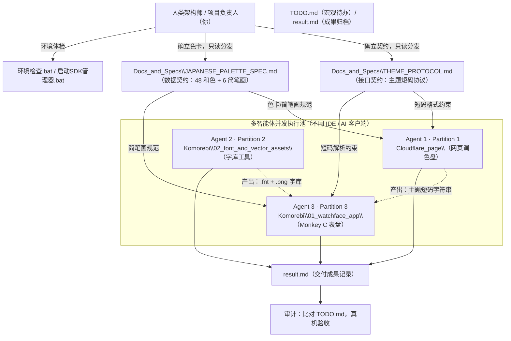

# Garmin Connect IQ 多智能体协同研发工作流 (WORKFLOW.md)

> 本工作流基于 [`ProjectManagementTemplate/`](ProjectManagementTemplate/README.md) 多智能体协同研发体系，针对 **Garmin Connect IQ 表盘全栈开发**（手表端 Monkey C + 网页调色盘 + 字体资源）的项目特点定制。
> 核心理念：**严格目录锁 + 接口先行契约（主题短码协议）+ 分区并行、串行集成**。

---

## 1. 协作模型图解

> **依赖方向为无环串行集成**：Partition 1 / 2 互不依赖可并行开发，Partition 3（表盘）只消费两者的**产出物**（短码字符串、字库文件），绝不反向修改它们的源码。

---

## 2. 分区与目录锁（Strict Directory Lock）

| 分区 | 锁定目录（唯一可写） | 只读输入（契约） | 产出物 | 验证方式 |
| :--- | :--- | :--- | :--- | :--- |
| **P0 契约区** | `Docs_and_Specs\`（仅人类架构师可改，改后须记录） | — | 短码协议、和色字典 | 人工评审 |
| **P1 网页调色盘** | `Cloudflare_page\` | `THEME_PROTOCOL.md` `JAPANESE_PALETTE_SPEC.md` | 可部署静态站 + 生成的短码 | 浏览器打开，短码符合协议正则 |
| **P2 字体资源** | `Komorebi\02_font_and_vector_assets\` | `PROJECT_PLAN.md` 第三节字体方案 | `.fnt` + `.png`（仅 `0-9 :`，≤8KB/套） | Python 脚本跑通 + 尺寸/字符集校验 |
| **P3 表盘工程** | `Komorebi\01_watchface_app\` | `THEME_PROTOCOL.md` P2 产出的字库文件 | 可编译的 `.prg` | 模拟器 `F5` 跑通 + 编译 0 错误 |

**军规：**
1. **绝对禁止**越界修改其他分区的文件；跨分区只交换「短码字符串」与「字库文件」这两种产出物。
2. **接口先行**：`THEME_PROTOCOL.md` 就是本项目的"纯虚接口"。任何智能体发现协议字段不够用，**不得私改协议**，必须停下来向人类架构师申请，由人类更新 `Docs_and_Specs\` 并同步所有分区。
3. **Mock-First**：P3 开发时若 P1 网页还没做好，直接在 `settings.xml` 默认值里硬填协议中的 4 套示例短码（如 `F2-B0-A0-F3F3F2-...`）驱动 `ThemeManager.mc` 测试，**绝不等待、绝不跨目录去写网页代码**。
4. **事实与偏好分离**：手表端 `ThemeManager.mc` 只消费解析后的**具体色值事实**（7 个 HEX）；"跟随日出日落""自动天气背景"等**用户偏好**留在设置项与 `DataProvider.mc` 边界处换算，不得渗透进渲染模块。

---

## 3. 单个智能体标准化操作步骤 (SOP)

1. **锚定目录锁**：接收任务提示词后，第一句话确认自己的可写目录（上表之一），列出只读契约文件。
2. **建立临时看板**：在锁定目录内创建 `TODO_PARTITION_{N}.md`，拆成 4~8 个可验证小步骤，每完成一步立即打勾。
3. **契约校验先行**：
   - P1：先把协议短码的生成函数写完，用 4 套默认主题短码做断言测试；
   - P3：先把 `ThemeManager.mc` 的短码解析器写完，用协议示例串做解析正确性验证。
4. **实现与自检**：Monkey C 编译 0 错误 0 警告；网页在 Chrome/手机视口无报错；Python 脚本可重复执行且幂等。
5. **清理与归档**：全部步骤完成后删除 `TODO_PARTITION_{N}.md`，将成果按 `ProjectManagementTemplate\RESULT_TEMPLATE.md` 格式**追加**写入根目录 `result.md`（注明分区、文件清单、验证结果、遗留问题）。

---

## 4. 人类架构师的项目管控节奏

| 阶段 | 核心动作 | 关键交付物 |
| :--- | :--- | :--- |
| **启动期** | 双击 `环境检查.bat` 体检环境；`启动SDK管理器.bat` 下载 SDK 并 Use as current SDK；VS Code `Monkey C: Verify Installation` | 环境 5 项全 OK |
| **契约期** | 审定 `THEME_PROTOCOL.md` 与 `JAPANESE_PALETTE_SPEC.md`，冻结 v1 字段（此后改动须同步三方） | 冻结的契约文档 |
| **并行开发期** | 将 P1 / P2 任务提示词分发至不同 AI 会话并发攻坚；P3 用默认短码 + 系统字体先行搭骨架 | 各分区代码、`result.md` 追加记录 |
| **集成期** | P2 字库拷入 `01_watchface_app\resources\fonts\`；P1 短码粘贴进 Garmin Connect 设置项，打通「网页 → 手机 → 手表」全链路 | 模拟器全链路演示 |
| **真机验收** | `Monkey C: Build for Device` 导出 `.prg` → 拖入手表 `/GARMIN/APPS/`；对照 `TODO.md` 逐项验收，输出盲区清单 | `.prg` 上表、`TODO_missing.md` |

---

## 5. 本项目专属注意事项 (Troubleshooting)

1. **MIP 64 色硬约束**：反射屏机型（Fenix 7 / FR255 / Enduro 2）每个 RGB 通道只有 `00/55/AA/FF` 四档。P1 网页必须提供 MIP 量化预览，P3 的 `ThemeManager.mc` 必须做最近邻吸附，保证网页所见 == 真机所得。
2. **内存红线**：表盘字库只允许 `0-9 :` 共 11 字符（3~8KB/套）；背景一律纯代码矢量绘制，**禁止**引入任何 PNG 背景图。
3. **AOD 息屏保护**：`WatchFaceView.mc` 休眠时必须隐藏秒针与重度图层；秒钟刷新必须走 `onPartialUpdate` 局部裁剪框，禁止每秒刷全屏。
4. **模拟器 ≠ 真机**：字体渲染、MIP 色阶在模拟器上可能过于乐观，涉及配色与字号的最终判定必须在真机（或 MIP 预览模式）验收。
5. **私钥与产物不入库**：`developer_key.der`、`bin/`、`*.prg` 已在 `.gitignore`，任何智能体不得尝试提交或修改 `.gitignore` 放开这些规则。
